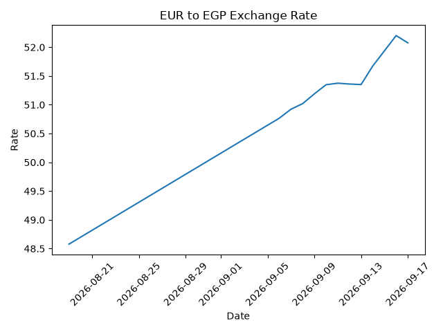

# EUR/EGP Exchange Rate Tracker

Tracks the EUR to EGP exchange rate over time using a free public API,
with a script to visualize the trend.

## What it does
- Pulls daily EUR→EGP rate from open.er-api.com
- Appends it to a running CSV
- Seeded with ~1 month of historical data
- Generates a trend chart with pandas + matplotlib

## How to run
1. `pip install requests pandas matplotlib`
2. `python fetch_daily.py` — adds today's rate to rates.csv
3. `python analyze.py` — generates chart.png

## Sample output

## What I'd improve next
- Add a moving average to smooth daily noise
- Automate the daily fetch (cron job / scheduled task)
- Track multiple currency pairs